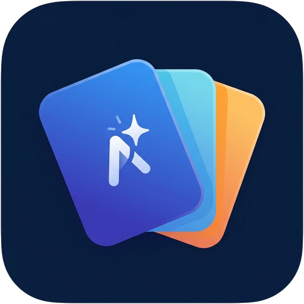

<div align="center">



# Nightly Vocab / LexiContext

**Contextual English Vocabulary Acquisition System with 8-Stage Spaced Repetition (SRS), Google Gemini AI, Multi-accent Pronunciation, Telegram Bot Integration & Super-Admin Control Panel.**

[](https://python.org)
[](https://djangoproject.com)
[](LICENSE)
[](https://t.me)
[](https://ai.google.dev)
[](install.sh)

[English](#-english) • [Deutsch](#-deutsch) • [فارسی](#-فارسی-persian)

---

</div>

<br/>

<div id="english"></div>

## 🇬🇧 English

### Overview
**Nightly Vocab** is a self-hosted, full-stack vocabulary acquisition platform designed around cognitive science and modern linguistics. Instead of memorizing isolated word lists, learners paste authentic daily English reading materials (articles, newsletters, book excerpts). The application intelligently tokenizes the text, allowing one-click selection of single words or multi-word idioms. Extracted terms are fed into an automated **8-stage Spaced Repetition System (SRS)** featuring three pedagogical flashcard modes, native & TTS pronunciation, a dedicated Telegram bot with automated review reminders, and an enterprise-grade admin management portal.

### ✨ Key Features
- **Context-First Reading Surface:** Paste articles or book chapters; select words and phrases with automatic sentence context capture and lemma identification.
- **8-Stage Spaced Repetition Engine (SRS):** Exponential review intervals ($1, 2, 4, 7, 15, 30, 60, 120$ days) with adaptive penalty algorithms for lapses.
- **3 Dynamic Flashcard Modalities:**
  - *Type 1 (Recognition):* Contextual sentence inspection with target word highlighted.
  - *Type 2 (Guided Spelling):* Masked letter boxes targeting orthographic memory.
  - *Type 3 (Full Dictation):* Audio-prompted sentence blank completion.
- **Resilient Multi-Accent Audio:** Real human UK/US pronunciations with instant local browser `SpeechSynthesis` fallback.
- **Interactive Telegram Bot:** Daily review notifications, queue evaluation, dynamic time adjustment, Force-Join subscription verification, anti-spam rate limiting, and MMR streak tracking.
- **Super-Admin Control Hub (`/manage/`):** Global AI token usage quotas, BYOK (Bring Your Own Key) management, audit logging, user activation/suspension, and real-time alerts.

---

### 🚀 One-Click Quick Installation (Production VPS)
Like modern server management panels (e.g., Sanaei x-ui), Nightly Vocab includes an automated zero-conflict installer script. It automatically configures Nginx, Let's Encrypt SSL, Python Virtualenv, Systemd services, and generates secure cryptographic keys.

Run the following command on your fresh Ubuntu / Debian server as **root**:

```bash
bash <(curl -Ls https://raw.githubusercontent.com/bruh-404/lexicontext/main/install.sh)
```

The installer will guide you interactively through:
1. Entering your custom domain (e.g., `vocab.yourdomain.com`).
2. Automatic Let's Encrypt HTTPS/SSL provisioning.
3. Creating your superuser admin account.
4. Optional input for Google Gemini API Key and Telegram Bot Token (can be skipped and configured later in the web panel).

---

### 🛠️ Server Management Command (`vocab`)
Once installed, manage your entire server anytime simply by typing:

```bash
vocab
```

This launches the interactive terminal menu:
```
  ======================================================
  Nightly Vocab / LexiContext — Server Management CLI
  ======================================================
  1) Start Service
  2) Stop Service
  3) Restart Service
  4) Live Real-time Logs (journalctl)
  5) Update System from GitHub (One-click Git Pull + Migration)
  6) Change Domain & Renew SSL
  7) Configure AI Keys, Telegram Token & Google Secrets
  8) Manage Superuser Account (Create / Reset Password)
  9) Full Backup (Database + Media + Settings)
  10) Uninstall
  0) Exit
```

You can also execute direct CLI subcommands:
```bash
vocab status      # Check service health
vocab restart     # Restart Gunicorn service
vocab update      # Pull latest git version and migrate
vocab logs        # Stream live production logs
vocab backup      # Generate timestamped archive
```

---

### 📖 Manual Production Deployment Runbook (Ubuntu 24.04 LTS)

#### 1. Server Preparation
```bash
sudo apt-get update && sudo apt-get install -y curl git ufw ca-certificates
```

#### 2. Initial Database Migrations & Superuser
```bash
python manage.py migrate --settings=config.settings.prod
python manage.py createsuperuser --settings=config.settings.prod
python manage.py collectstatic --noinput --settings=config.settings.prod
```

#### 3. Telegram Webhook Setup
Register your production HTTPS webhook endpoint with Telegram:
```bash
python manage.py set_telegram_webhook https://vocab.example.com/api/telegram/webhook/ --settings=config.settings.prod
```

#### 4. Automated Database Backup & Disaster Recovery (`backup.sh`)
Automate daily backups via cron:
```bash
# In crontab (crontab -e):
0 3 * * * /opt/nightly-vocab/scripts/backup.sh >/dev/null 2>&1
```

To restore from a PostgreSQL disaster recovery dump using `psql`:
```bash
gunzip < /var/backups/lexicontext/lexicontext_db_latest.sql.gz | psql -U lexi -h localhost -d lexicontext
```

---

<br/>

<div id="deutsch"></div>

## 🇩🇪 Deutsch

### Projektübersicht
**Nightly Vocab** ist eine moderne, selbst gehostete Webanwendung zum Erlernen von englischem Wortschatz basierend auf kognitiven Lernprinzipien und dem Prinzip der räumlichen Wiederholung (Spaced Repetition System – SRS). Anstelle isolierter Vokabellisten verarbeiten Lernende authentische Texte (Artikel, Fachliteratur, Nachrichten). Die Plattform tokenisiert den Text und ermöglicht die Extraktion von Wörtern und Phrasen direkt im Satzkontext. Das integrierte **8-Stufen-SRS** trainiert Erkennung, Rechtschreibung und Diktat mithilfe von menschlichen Aussprache-Dateien, einem Telegram-Bot für tägliche Erinnerungen und einem umfassenden Admin-Dashboard.

### ✨ Hauptmerkmale
- **Kontextbasierte Texterfassung:** Einfügen beliebiger englischer Texte mit sofortiger Satz- und Phrasenextraktion.
- **8-Stufen-SRS:** Wissenschaftlich optimierte Intervalle ($1, 2, 4, 7, 15, 30, 60, 120$ Tage) mit intelligenter Fehlerkompensation.
- **3 Lernkarten-Typen:**
  - *Typ 1 (Wiedererkennung):* Satzkontext mit hervorgehobenem Zielwort.
  - *Typ 2 (Geführte Rechtschreibung):* Maskierte Buchstabenfelder zur Festigung des Schriftbildes.
  - *Typ 3 (Vollständiges Diktat):* Akustisch gestütztes Ausfüllen von Satzlücken.
- **Zweisprachige Aussprache:** Authentische UK/US-Menschstimmen mit unterbrechungsfreiem Browser-TTS-Fallback.
- **Automatisierter Telegram-Bot:** Tägliche Erinnerungsbenachrichtigungen, Lernfortschritt, flexible Lernzeiten, Anti-Spam-Ratenbegrenzung und Kanal-Mitgliedschaftsüberprüfung.
- **Zentrales Admin-Dashboard (`/manage/`):** Überwachung von KI-Quoten (Google Gemini), Benutzerverwaltung, Audit-Logs und Systemwarnungen.

---

### 🚀 Ein-Klick-Installation (Linux VPS)
Das automatisierte Installationsskript richtet die gesamte Umgebung (Nginx, Let's Encrypt SSL, Systemd-Dienst, Python-Virtualenv) ohne Konflikte mit bestehenden Diensten ein:

```bash
bash <(curl -Ls https://raw.githubusercontent.com/bruh-404/lexicontext/main/install.sh)
```

### 🛠️ CLI-Verwaltungstool (`vocab`)
Verwalten Sie den Server jederzeit mit dem interaktiven Befehl:
```bash
vocab
```
Optionen umfassen Dienststatus, automatische Aktualisierung von GitHub (`vocab update`), SSL-Zertifikatserneuerung (`vocab ssl`) und Datensicherung (`vocab backup`).

---

<br/>

<div id="persian"></div>

## 🇮🇷 فارسی (Persian)

### معرفی سامانه
**نایتلی وکب (Nightly Vocab)** یک سامانه جامع و مدرن برای یادگیری عمیق و اصولی واژگان و اصطلاحات زبان انگلیسی در بستر واقعی متن (Contextual Learning) است. در این متدولوژی، زبان‌آموز به جای حفظ طوطی‌وار لغات تک، متن‌های انگلیسی مورد علاقه خود (مقالات، اخبار، رمان یا خبرنامه‌ها) را وارد سایت می‌کند. سامانه متن را به صورت تعاملی بخش‌بندی کرده و با یک کلیک، کلمات یا عبارات چندکلمه‌ای به همراه جمله بستر و نقش دستوری استخراج می‌شوند. سپس کلمات در **سیستم تکرار فاصله‌دار ۸ مرحله‌ای (SRS)** با ۳ نوع فلش‌کارت هوشمند، تلفظ صوتی دوگانه، ربات تلگرام و پنل مدیریت ارشد آموزش داده می‌شوند.

---

### ✨ قابلیت‌ها و ویژگی‌های کلیدی
- **بستر مطالعه هوشمند متن:** استخراج واژگان و اصطلاحات چندکلمه‌ای با ثبت خودکار موقعیت دقیق در جمله و فرم ریشه (Lemma).
- **سیستم لایتنر/تکرار فاصله‌دار ۸ مرحله‌ای (SRS):** با فواصل تصاعدی ۱، ۲، ۴، ۷، ۱۵، ۳۰، ۶۰ و ۱۲۰ روز و الگوریتم بازگشت مرحله ملایم در صورت وقفه.
- **۳ شیوه متنوع تمرین فلش‌کارت:**
  - *نوع ۱ (تست ادراک):* مشاهده متن جمله و واژه با پخش صوتی خودکار تلفظ.
  - *نوع ۲ (دیکته هدایت‌شده):* خانه‌های پنهان‌شده حروف برای فعال‌سازی حافظه املایی.
  - *نوع ۳ (دیکته کامل و لیسنینگ):* شنیدن تلفظ صوتی و نوشتن کامل واژه در جای‌خالی جمله.
- **پخش تلفظ صوتی قدرتمند:** فایل‌های واقعی تلفظ امریکن و بریتیش به همراه سیستم هوشمند جایگزین محلی مرورگر (SpeechSynthesis) با تاخیر صفر در زمان قطعی اینترنت بین‌الملل.
- **ربات تلگرام پیشرفته:**
  - ارسال اعلان‌های یادآوری مرور روزانه سر ساعت دلخواه کاربر.
  - نمایش وضعیت استمرار، تعداد لغات فعال، تسلط‌یافته و رتبه MMR الهام‌گرفته از بازی‌های آنلاین.
  - قابلیت تنظیم عضویت اجباری (Force Join) در کانال‌ها یا گروه‌های تلگرام با امکان افزودن چند کانال از پنل ادمین.
  - سیستم محافظت در برابر اسپم (Rate Limiting ساعتی و روزانه).
- **داشبورد مدیریت ارشد سامانه (`/manage/`):**
  - گزارش مصرف سهمیه توکن‌های هوش مصنوعی (Google Gemini) و نظارت بر سقف روزانه و ماهانه.
  - هشدار هوشمند در داشبورد در صورت خالی بودن کلید هوش مصنوعی یا توکن ربات تلگرام.
  - قابلیت اتصال اختصاصی کلید هوش مصنوعی توسط هر کاربر (BYOK).
  - ثبت وقایع امنیتی و حسابرسی (Audit Log) و مدیریت کامل کاربران (مسدودسازی/فعال‌سازی).

---

### 🚀 اسکریپت نصب خودکار یک‌خطی (مشابه پنل سنایی / X-UI)
سامانه دارای یک اسکریپت نصب جامع است که تمامی پیش‌نیازها، وب‌سرور Nginx، گواهی رایگان SSL (Let's Encrypt)، سرویس سیستمی Systemd و محیط پایتون را **بدون کوچکترین تداخل با سایر برنامه‌های سرور** پیکربندی می‌کند.

تنها با اجرای دستور زیر بر روی سرور اوبونتو یا دبیان خام (با دسترسی root):

```bash
bash <(curl -Ls https://raw.githubusercontent.com/bruh-404/lexicontext/main/install.sh)
```

مراحل اسکریپت به صورت تعاملی و فارسی:
1. دریافت دامنه شما (مثلاً `vocab.yourdomain.com`).
2. دریافت و نصب خودکار گواهی رسمی HTTPS / SSL.
3. ساخت اکانت مدیریت ارشد (Superuser).
4. دریافت اختیاری توکن ربات تلگرام و کلید هوش مصنوعی Gemini (در صورت تمایل می‌توانید اینتر بزنید و بعداً از طریق منوی تنظیمات سایت وارد کنید).

---

### 🛠️ ابزار مدیریت تحت ترمینال (`vocab`)
پس از نصب، در هر زمان کافیست در ترمینال سرور دستور زیر را تایپ کنید:

```bash
vocab
```

منوی زیر باز خواهد شد:

```text
  ======================================================
  Nightly Vocab / LexiContext — ابزار مدیریت سرور (CLI)
  ======================================================
  1) شروع سرویس (Start)
  2) توقف سرویس (Stop)
  3) راه‌اندازی مجدد سرویس (Restart)
  4) مشاهده لاگ‌های زنده (Live Logs)
  5) به‌روزرسانی سامانه از گیت‌هاب (Update from GitHub)
  6) تغییر دامنه و تمدید SSL (Domain & SSL)
  7) تنظیم توکن ربات، هوش مصنوعی و گوگل (API Keys & Secrets)
  8) ایجاد یا تغییر رمز مدیر ارشد (Admin User)
  9) پشتیبان‌گیری از داده‌ها (Backup)
  10) حذف کامل سامانه (Uninstall)
  0) خروج (Exit)
```

دستورات مستقیم سریع:
```bash
vocab status       # بررسی وضعیت زنده بودن سرویس و دامنه
vocab restart      # ری‌استارت سرویس وب
vocab update       # پول گرفتن آخرین کامیت‌ها از گیت‌هاب و اعمال مایگریشن‌ها
vocab logs         # مشاهده زنده خروجی و لاگ‌های خطا
vocab backup       # ساخت آرشیو فشرده پشتیبان از دیتابیس و مدیا
```

---

### 📁 ساختار تنظیمات محیطی (.env)
```dotenv
DOMAIN=vocab.yourdomain.com
SITE_URL=https://vocab.yourdomain.com
DJANGO_SETTINGS_MODULE=config.settings.prod
DEBUG=False

# SQLite به صورت پیش‌فرض یا PostgreSQL
DATABASE_URL=sqlite:////opt/nightly-vocab/db.sqlite3

# Google Gemini AI
AI_PROVIDER=gemini
GEMINI_API_KEY=AIzaSy...
AI_MODEL=gemini-2.5-flash

# Telegram Bot
TELEGRAM_BOT_TOKEN=123456789:ABC...
TELEGRAM_BOT_USERNAME=@YourBot
```

---

### 📜 لایسنس
پروژه تحت لایسنس **MIT** منتشر شده است. هرگونه استفاده، شخصی‌سازی و توسعه آزاد است.
